<div align="center">


<br>

[](https://t.me/maxouniai)
[](https://www.youtube.com/watch?v=YIMZx5zFabQ)

</div>

<br>

## ❯ cat about.md

Привет, я Макс. Работаю Data Scientist'ом в **MagnitTech**, до этого был в **Wildberries**.

В DS пришёл с нуля в 19 лет, без профильного образования, и прошёл больше 60 технических собеседований.
Всё, что понял по дороге, превращаю в посты, видео и репозитории.
Сейчас в основном пишу про **вайбкодинг и AI-инструменты**: как с Claude Code собирать приложения, сайты
и даже монтировать видео. Остальное время — инженерка и DS/ML простыми словами.

```text
focus   ─  вайбкодинг · AI-инструменты · инженерка · DS/ML простым языком
stack   ─  python · swift · typescript · claude code
```

<br>

## ❯ git log --graph --oneline career

```text
*   HEAD -> main   MagnitTech · Data Scientist
*                  Wildberries · Data Scientist
*                  60+ техничек, несколько офферов
*                  вкат в DS с нуля после разговора с одноклассником
| * universe       заказные студенческие работы · инвестиции · маркетинг   (dead ends)
|/
*   init           3 курс не айтишного вуза, 19 лет, ни одной строчки на Python
```

<br>

## ❯ ls ~/media

| канал | о чём | |
|:--|:--|:--|
| **maxouni \| ai & vibecoding**<br>[`@maxouniai`](https://t.me/maxouniai) | Основной проект. Вайбкодинг, AI-инструменты, инженерка, DS/ML простым языком. Серия про ветки Data Science, гайды по монтажу видео с Claude Code, разборы инструментов. | [**открыть →**](https://t.me/maxouniai) |
| **YouTube**<br>первое видео | **Вся карта Data Science за 19 минут.** Семь веток от Classic ML до HFT простыми словами и разбор, как по вакансии понять, куда тебя на самом деле зовут. Смонтировано целиком с Claude. | [**смотреть →**](https://www.youtube.com/watch?v=YIMZx5zFabQ) |

<br>

## ❯ ls ~/projects

```text
~/projects
├── coil/          iOS-трекер привычек · SwiftUI · SwiftData · CloudKit · WidgetKit
├── mlsd/          45 кейсов ML System Design с реальных собеседований
└── mlcourse-ai/   открытый курс ML от OpenDataScience: домашки и решения
```

<table>
<tr>
<td width="33%" valign="top">

### 🌀 coil
Трекер привычек для iPhone. Функционально повторяет [Loop Habit Tracker](https://github.com/iSoron/uhabits), но с нативным iOS-дизайном.
Бесплатный, без рекламы и аккаунтов.

- сила привычки по экспоненциальной скользящей средней
- статистика, серии, календарь за всю историю
- виджеты и синхронизация через iCloud (опционально)
- русский и английский

`Swift` `SwiftUI` `SwiftData` `CloudKit` `WidgetKit`

<sub>пока в приватном репозитории</sub>

</td>
<td width="33%" valign="top">

### 🧠 [mlsd](https://github.com/aimnoux/mlsd)
Сборник кейсов по ML System Design с реальных интервью на Data Scientist и ML Engineer.
Сайт с фильтрами по направлению и домену: Classic ML, RecSys, CV, LLM, AI-engineer.

- 45 кейсов, 12 доменов
- собрано вместе с [Григорием](https://t.me/doommot_channel) и [Ромой](https://t.me/Ai_bolno_ml)
- vanilla TS, без фреймворков

[**aimnoux.github.io/mlsd →**](https://aimnoux.github.io/mlsd/)

`TypeScript` `Vite` `GitHub Pages`

</td>
<td width="33%" valign="top">

### 📚 [mlcourse-ai](https://github.com/aimnoux/mlcourse-ai)
Форк открытого курса [mlcourse.ai](https://mlcourse.ai) от OpenDataScience.
Лекции, статьи, домашки и решения по темам курса: от Pandas до обучения без учителя.

- домашки в `homeworks/`
- решения в `solutions/`
- форк: все ссылки на лекции и статьи сохранены

`Jupyter` `pandas` `scikit-learn`

</td>
</tr>
</table>

<br>

## ❯ whoami

```text
$ whoami
max

$ man me | grep -i contact
telegram → @maxouniai
```

<br>


