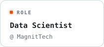
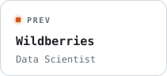
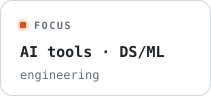
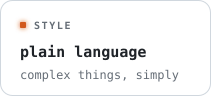
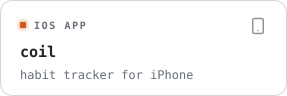
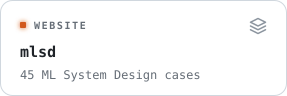
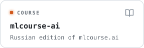
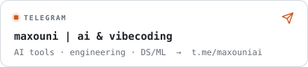
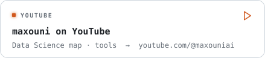

<picture><source media="(prefers-color-scheme: dark)" srcset="assets/dark/hero.svg"></picture>

<picture><source media="(prefers-color-scheme: dark)" srcset="assets/dark/label-about.svg"></picture>

<picture><source media="(prefers-color-scheme: dark)" srcset="assets/dark/tile-role.svg"></picture><picture><source media="(prefers-color-scheme: dark)" srcset="assets/dark/tile-prev.svg"></picture><picture><source media="(prefers-color-scheme: dark)" srcset="assets/dark/tile-focus.svg"></picture><picture><source media="(prefers-color-scheme: dark)" srcset="assets/dark/tile-style.svg"></picture>

<picture><source media="(prefers-color-scheme: dark)" srcset="assets/dark/label-projects.svg"></picture>

<a href="https://github.com/aimnoux/coil"><picture><source media="(prefers-color-scheme: dark)" srcset="assets/dark/tile-coil.svg"></picture></a><a href="https://aimnoux.github.io/mlsd/"><picture><source media="(prefers-color-scheme: dark)" srcset="assets/dark/tile-mlsd.svg"></picture></a><a href="https://github.com/aimnoux/mlcourse-ai"><picture><source media="(prefers-color-scheme: dark)" srcset="assets/dark/tile-mlcourse.svg"></picture></a>

<picture><source media="(prefers-color-scheme: dark)" srcset="assets/dark/label-stats.svg"></picture>

<picture><source media="(prefers-color-scheme: dark)" srcset="https://github-readme-stats.vercel.app/api?username=aimnoux&show_icons=true&rank_icon=github&custom_title=GitHub%20Stats&card_width=440&border_radius=12&bg_color=1a1c1e&border_color=383c40&title_color=f0883e&text_color=d9dcdf&icon_color=aeb6be"></picture><picture><source media="(prefers-color-scheme: dark)" srcset="https://streak-stats.demolab.com?user=aimnoux&card_width=440&card_height=195&border_radius=12&background=1a1c1e&border=383c40&ring=f0883e&fire=f0883e&currStreakNum=ffffff&sideNums=ffffff&currStreakLabel=d9dcdf&sideLabels=9ba1a7&dates=6b6f72&stroke=383c40"></picture>

<picture><source media="(prefers-color-scheme: dark)" srcset="assets/dark/label-media.svg"></picture>

<a href="https://t.me/maxouniai"><picture><source media="(prefers-color-scheme: dark)" srcset="assets/dark/tile-telegram.svg"></picture></a><a href="https://www.youtube.com/@maxouniai"><picture><source media="(prefers-color-scheme: dark)" srcset="assets/dark/tile-youtube.svg"></picture></a>

